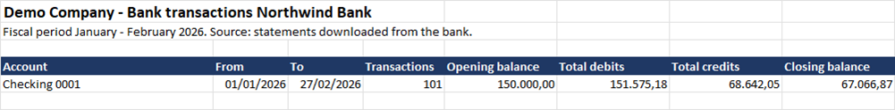
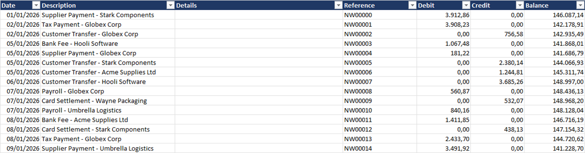

# bank-statement-consolidation

[](https://github.com/lautarobermudez/bank-statement-consolidation/actions/workflows/ci.yml)

Turn a messy folder of bank statements into **one clean Excel workbook per bank**, with a sheet per account, a summary, and a running balance that has been independently verified.

Packaged as a [Claude Code skill](https://docs.claude.com/en/docs/claude-code/skills) (`consolidar-extractos`) with plain Python scripts underneath, so it works with Claude guiding the process or from the command line. *(Spanish version: [README.es.md](README.es.md).)*

## The problem

Finance teams are regularly asked for "all bank statements for the fiscal year". In practice that means:

- several banks and several accounts (some opened or closed during the year);
- the same period delivered as `.xls`, `.xlsx`, `.csv` and `.pdf`, monthly **and** weekly **and** "grouped" files that overlap;
- exact duplicates, mislabeled files, and descriptions that change between downloads of the same bank;
- no ERP to reconcile against.

Merging these by hand is slow and risky: one duplicated or dropped transfer silently breaks every balance after it.

## What it does

```
inventory -> read -> unify -> pdf -> excel -> verify
```

| Step | What happens | Output (`<out>/trabajo/`) |
|---|---|---|
| `inventario` | Detects bank, account, format and date range of every file; flags duplicates, unidentified accounts and PDFs with no spreadsheet twin | `inventario.csv` |
| `leer` | Reads every xls/xlsx/csv into one schema; checks each file's own running balance | `crudos.csv` |
| `unificar` | Keeps **one source file per day and account**; rows that only another file has are added and flagged | `unificados.csv`, `fuentes.csv`, `cortes.csv` |
| `pdf` | Reads only the PDFs that have no spreadsheet version and adds the rows that are genuinely new | `final.csv` |
| `excel` | One workbook per bank: Summary + one sheet per account (+ `Avisos` only if a balance does not chain) | `<Bank> <Company> - Movimientos.xlsx` |
| `verificar` | Re-opens the workbooks and recomputes row counts, debit/credit totals and running balance | exit code 0 / 1 |

Rows pulled from a secondary file are listed in `interno/Trazabilidad - ...xlsx`, kept out of the deliverable so the report stays clean while every row remains traceable.

## See it in 10 seconds

```bash
pip install -r skills/consolidar-extractos/scripts/requirements.txt
python examples/make_demo.py
```

It builds a small **fictional** set of messy statements (monthly + grouped + weekly files that overlap, different wording and intra-day order between downloads, a duplicate, a newest-first file) in `examples/demo_input/`, runs the whole pipeline and writes one workbook per bank to `examples/demo_output/`. 373 raw rows become 220 unified rows and the verification passes.

What the output looks like (real Excel render of the demo workbook):





## Quick start

```bash
pip install -r skills/consolidar-extractos/scripts/requirements.txt

cp skills/consolidar-extractos/scripts/proyecto.ejemplo.json proyecto.json   # edit paths and account rules
python skills/consolidar-extractos/scripts/consolidar.py inventario --config proyecto.json
# review the inventory with whoever owns the data, add rules for unknown banks/accounts, then:
python skills/consolidar-extractos/scripts/consolidar.py todo --config proyecto.json
```

To use it as a Claude Code skill run `./install.sh` (copies it into `~/.claude/skills`; re-run with `--force` after a `git pull`) and ask Claude to consolidate a folder of bank statements.

## Design decisions (each one fixed a real bug)

- **Never invent or hide anything.** A balance that does not chain is reported, not "fixed". An account or bank it cannot identify is asked about, not guessed.
- **Compare rows by date + debit + credit, never by text.** Banks word the same transaction differently between a monthly and a grouped download; text-based matching duplicated two multi-million transfers in the first prototype.
- **Order inside a day is not stable between downloads**, so the running balance differs row by row even when the transactions are identical. The tool uses one file per day and account instead of mixing sources.
- **Formats are recognised by content, not file name.** One table reader with header synonyms (Spanish and English) covers most banks; a new layout is a small adapter.
- **Running balance is the safety net.** `previous balance + credit - debit = balance` is checked per file, after unifying, and again from the final workbooks.
- **A statement is not a ledger.** The inventory step asks whether the files are bank statements or accounting-system ledgers; they look alike but must not be presented interchangeably.
- **Local only.** Bank data never leaves the machine.

## Tests

`skills/consolidar-extractos/tests/test_flujo.py` builds fictional statements from a known ground truth and checks that the pipeline recovers it exactly. It covers overlapping monthly/weekly/grouped files, different descriptions and intra-day order across downloads, a day split between two files, a newest-first file, an exact duplicate, a file without balance, and an unidentifiable bank.

```bash
python skills/consolidar-extractos/tests/test_flujo.py
```

It also ran against a real fiscal year (4 banks, 7 accounts, 87 files, ~7,000 movements) and reproduced the hand-built reconciliation row for row; that data is not part of this repository.

## Limitations

- Scanned PDFs (images) are not read; ask the bank for the spreadsheet version.
- The generic PDF reader is low confidence by design; the balance check will expose a wrong read.
- `.xls` reading is exercised on real files only (no fixture generator for the legacy format).
- Currency handling assumes one currency per account.

## Roadmap

- Load the final dataset into PostgreSQL (movements table with idempotent loads keyed on the same row identity).
- Optional reconciliation against an accounting ledger.
- More bank adapters.

## License

MIT. See [LICENSE](LICENSE).
